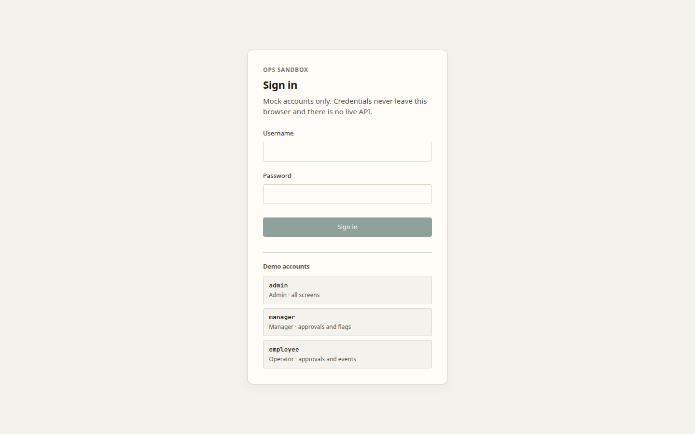
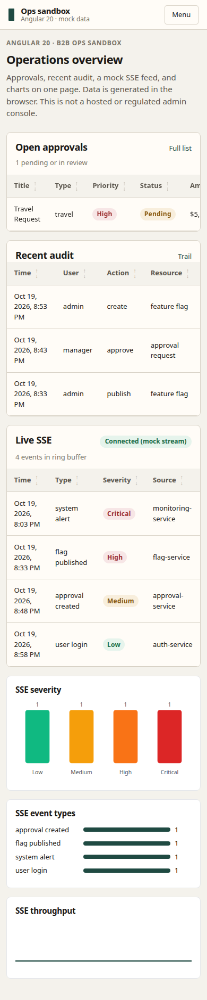

# angular-dashboard

Nx Angular app for the B2B ops sandbox (Signals, route/UI RBAC, dual-control approvals, mock SSE, audit). Mock backend only — not a production console.

Source: [`tessOu56/angular-dashboard-sandbox`](https://github.com/tessOu56/angular-dashboard-sandbox) at `7395dc7`. See [PROVENANCE.md](./PROVENANCE.md).

Aligned to this workspace: **Angular 20.3.3**, Node 24, pnpm 11. The satellite repo remains Angular 22 and is not modified.

## Run

```bash
pnpm exec nx serve angular-dashboard   # http://localhost:4200
pnpm exec nx test angular-dashboard
pnpm exec nx build angular-dashboard
pnpm exec nx lint angular-dashboard
```

Unauthenticated visits go to `/login`. Demo accounts: `admin` / `admin` (lands on `/slice`).

## Pages

Production Pages build uses base href `/nx-playground/angular-dashboard/`.

| Screen | Desktop | Mobile |
|--------|---------|--------|
| Sign in |  |  |
| Overview (`/slice`) |  |  |
