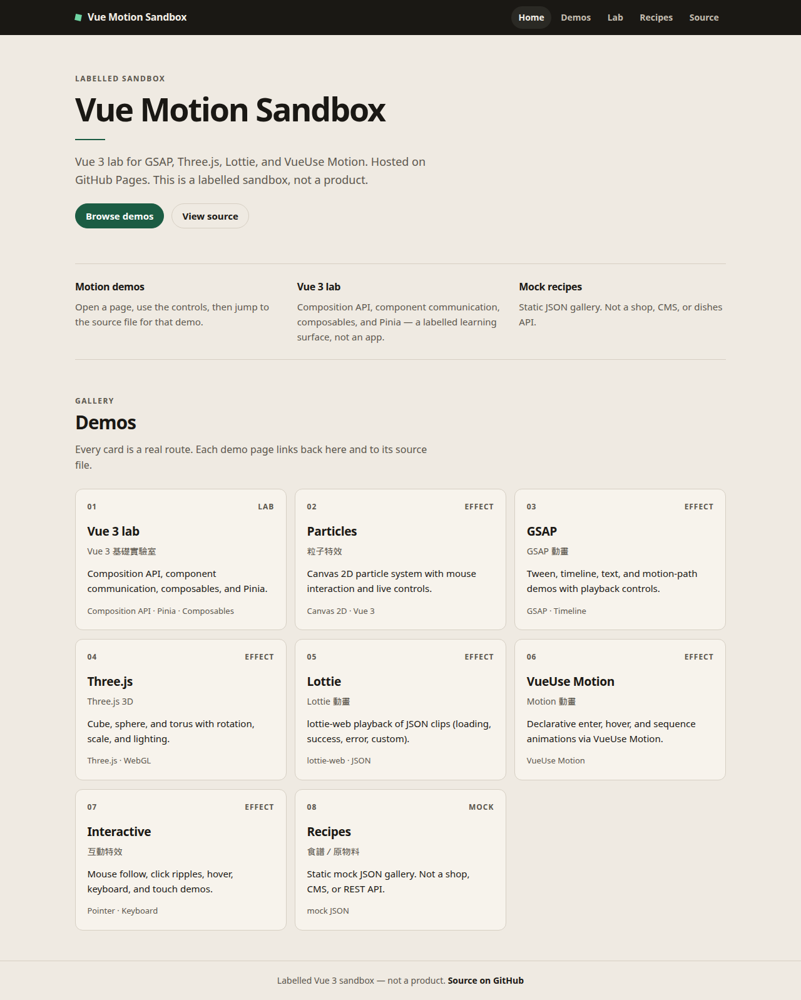
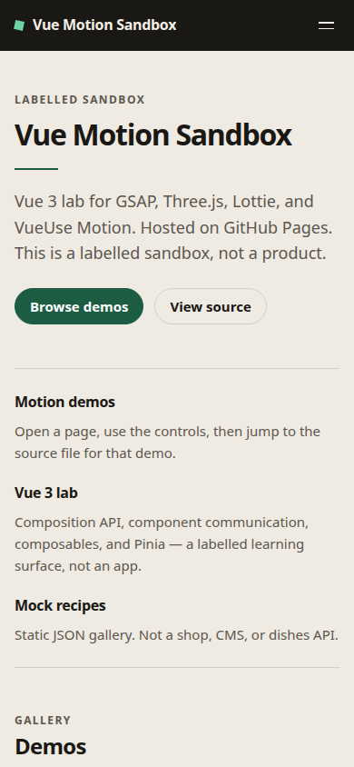

# vue-motion

Nx Vue 3 + Vite app for the motion sandbox (GSAP, Three.js, Lottie, VueUse Motion, Pinia lab). Labelled sandbox — not a product.

Source: [`tessOu56/vue-motion-sandbox`](https://github.com/tessOu56/vue-motion-sandbox) at `5acfdf7`. See [PROVENANCE.md](./PROVENANCE.md).

Aligned to this workspace: **Vue 3.5**, Vite 7, Tailwind 3, Node 24, pnpm 11. The satellite repo remains unmodified.

## Run

```bash
pnpm exec nx serve vue-motion   # http://localhost:8080
pnpm exec nx test vue-motion
pnpm exec nx build vue-motion
pnpm exec nx lint vue-motion
```

## Pages

Production build uses base `/nx-playground/vue-motion/`.

| Screen | Desktop | Mobile |
|--------|---------|--------|
| Home |  |  |
