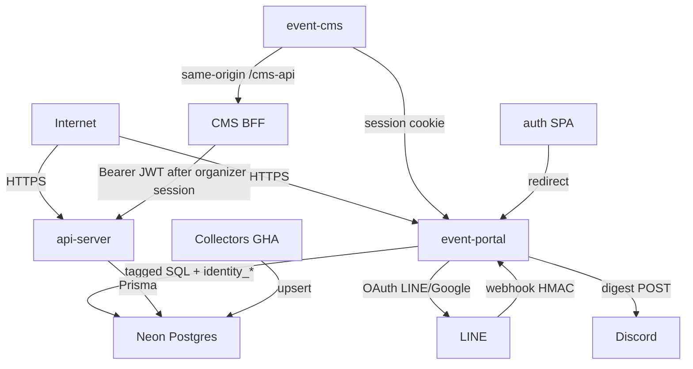

# Threat model — nx-playground event stack

## Executive summary

The internet-facing risk concentrates on **event-portal** (Vercel: LINE webhook, Better Auth `/api/auth/*`, public exhibition search, weekly Discord digest) and **api-server** (Render: public catalog reads, JWKS JWT writes, organizer user/stats). Neon holds the published exhibition catalog, embeddings, catalog `users` rows, and identity tables (`identity_*`, `user_role`). LINE/Discord secrets, `BETTER_AUTH_SECRET`, JWKS private keys, and `DATABASE_URL` are the highest-value credentials. Phase 1 identity replaces custom LINE PKCE cookies and local Kratos with Better Auth (LINE Taiwan + Google, database httpOnly sessions) and Nest JWKS verification. Residual High items in this model are closed; remaining open items are Low plus operator follow-through (Google/LINE console callbacks, first admin grant, collector password, hosted CMS cookie domain).

## Scope and assumptions

**In scope:** `apps/event-portal`, `apps/event-cms`, `apps/api-server`, `apps/auth`, `apps/api-mock`, `tools/collectors`, shared libs used by those apps, `render.yaml`, `vercel.json`, `.github/workflows/collect-*.yml`.

**Out of scope:** `apps/profile`, `apps/mobile-approvals`, `labs/`, Angular/Vue satellites, retired ticketing/ECPay (dropped in Prisma), and the Supabase `track-view` function (profile analytics, not event-stack).

**Assumptions** (inferred from repo + deployment files; they drive ranking):

- Production C-end is `nx-event-portal.vercel.app` with Neon `DATABASE_URL` on the Next.js server and LINE Messaging/Login configured.
- Nest is intended to be internet-reachable (`render.yaml` public web service) against the same Neon database.
- Organizers and attendees authenticate to **Better Auth on event-portal** (`/api/auth/*`, LINE `line-tw` + Google, no passwords). Elevated roles (`organizer` / `admin`) live in `user_role` and are admin-assigned (CLI `grant-identity-role`). Nest verifies Bearer JWTs via JWKS (`iss`/`aud`/`exp`). `ADMIN_API_TOKEN` is machine-only (cron/collector). CMS BFF requires an organizer/admin session and never attaches the admin token.
- Collectors run only as GitHub Actions / local CLI (no HTTP listener).
- `api-mock` on Vercel stays in-memory (`EVENT_STACK_STORE` not postgres).
- Catalog content is public once `status = 'published'`; drafts and `users` emails are not.

**Open questions that would change ranking:**

1. Is Nest on Render live today against production Neon, or still dark?
2. Is event-cms hosted (it must run the Vite `/cms-api` BFF; static-only hosting cannot write)?
3. **Answered:** identity is Better Auth on the portal (same Vercel project). Hosted CMS on a different site needs a shared parent cookie domain or OIDC (phase 1 is localhost / same-site). First admin must be granted via CLI after a social sign-in. Passkeys are phase 2.

## System model

### Primary components

| Component                | Runtime                   | Evidence                                                      |
| ------------------------ | ------------------------- | ------------------------------------------------------------- |
| event-portal             | Next.js on Vercel         | `vercel.json`, `apps/event-portal/src/app/api/**`             |
| api-server               | NestJS + Prisma on Render | `apps/api-server/src/main.ts`, `render.yaml`                  |
| event-cms                | Vite SPA                  | `apps/event-cms/vite.config.ts`                               |
| auth                     | Vite SPA → portal login   | `apps/auth/src/route.tsx`                                     |
| api-mock                 | In-memory OpenAPI mock    | `apps/api-mock/src/handler.ts`                                |
| Collectors               | CLI / GitHub Actions      | `tools/collectors/**`, `.github/workflows/collect-taipei.yml` |
| Neon Postgres + pgvector | Shared catalog + users    | `apps/api-server/prisma/schema.prisma`                        |
| LINE / Discord           | External                  | webhook + OAuth routes; `DISCORD_WEBHOOK_URL`                 |

### Data flows and trust boundaries

- **Internet → event-portal (HTTPS).** Search query strings, Better Auth OAuth callbacks, LINE webhook raw body. Controls: Better Auth trusted origins + PKCE on LINE; HMAC on webhook (`apps/event-portal/src/libs/line/bot/signature.ts:17-30`), shared rate limits (Upstash or Neon `portal_kv`, memory fallback), `CRON_SECRET` on digest. Validation: query length cap 2048 (`search/route.ts:17-25`); webhook 256 KiB (`webhook/route.ts:16-44`).
- **LINE → event-portal webhook (HTTPS).** Messaging events. Control: `x-line-signature` HMAC-SHA256 over raw bytes; fail closed if `LINE_CHANNEL_SECRET` unset (`webhook/route.ts:36-48`). Replay: reject stale `timestamp` (>10 min) and dedupe `webhookEventId` (24h TTL).
- **event-portal → Neon (TLS, tagged SQL).** Keyword / region / date / optional embedding vector. Control: server-only `DATABASE_URL`; `status = 'published'` (`sql.ts:247`); bound parameters (`sql.ts:229-261`); ILIKE wildcards stripped (`sql.ts:99-104`).
- **event-portal → LINE / Google token endpoints (HTTPS).** Authorization code + channel/client secrets via Better Auth. Control: PKCE on LINE; provider tokens stripped before persist (`line-account-map.ts`); session cookie httpOnly Secure SameSite=Lax. Email is optional and never used as an account-link key.
- **event-portal → Discord (HTTPS POST).** Digest text. Control: `CRON_SECRET` bearer (`digest/auth.ts:21-30`); webhook URL host/path allowlist (`publish.ts:10-38`); `allowed_mentions.parse = []` (`publish.ts:81-84`).
- **Internet → api-server (HTTPS `/api`).** Public event/catalog reads; Bearer JWT (JWKS) or `ADMIN_API_TOKEN` (machine) on mutations. Organizer users/stats require `organizer`/`admin` (`RolesGuard` default-deny). Controls: CORS allowlist (`main.ts:29-38`); `ValidationPipe` whitelist (`main.ts:41-47`); `IdentityGuard` + `RolesGuard` (`identity.guard.ts`, `roles.guard.ts`); JWT `iss`/`aud`/`exp` (`jwt-verify.ts`).
- **event-cms browser → CMS BFF `/cms-api` → api-server.** Browser sends the Better Auth cookie only. The Vite BFF calls portal `get-session` + `token`, requires organizer/admin, then forwards `Authorization: Bearer <jwt>` (`apps/event-cms/server/cms-bff.ts`). No organizer/admin secret is in the client bundle (`event-cms/vite.config.ts` `define`).
- **event-cms / auth SPA → event-portal Better Auth.** Session cookie on localhost (host-only, shared across ports). Hosted CMS on another site cannot reuse the cookie without a shared parent domain (phase 1 gap).
- **GitHub Actions collectors → Neon.** `COLLECTOR_DATABASE_URL` (role `event_collector`: SELECT/INSERT/UPDATE on `events` + `event_embeddings` only). Owner `DATABASE_URL` is migrate-only. Outbound fetch: HTTPS allowlist + `redirect: 'error'` (`tools/collectors/shared/ssrf.ts:60-100`).
- **Internet → api-mock.** Unauthenticated event writes if that process is reachable (`handler.ts` POST/PUT/DELETE). Assumed not production.

#### Diagram

## Assets and security objectives

| Asset                                         | Why it matters                                        | Security objective (C/I/A) |
| --------------------------------------------- | ----------------------------------------------------- | -------------------------- |
| Neon `events` + embeddings                    | Public catalog integrity; drafts are unpublished work | I, A (C for drafts)        |
| Neon `users` (email, role, status)            | Organizer PII and privilege state                     | C, I                       |
| Neon `identity_session.token` / JWKS keys     | Session takeover; forge Nest JWTs                     | C, I                       |
| `user_role`                                   | CMS / Nest privilege                                  | I                          |
| `DATABASE_URL`                                | Full catalog/user/identity read-write                 | C, I                       |
| `BETTER_AUTH_SECRET`                          | Forge portal sessions                                 | C, I                       |
| `LINE_CHANNEL_SECRET` / access token          | Forge webhooks; reply as the OA                       | C, I                       |
| `LINE_CLIENT_SECRET` / `GOOGLE_CLIENT_SECRET` | OAuth code exchange                                   | C                          |
| `ADMIN_API_TOKEN` (server-only)               | Machine Nest writes (cron/collector)                  | C, I                       |
| `CRON_SECRET` / `DISCORD_WEBHOOK_URL`         | Spam or hijack the digest channel                     | I, A                       |
| `EMBEDDING_API_KEY`                           | Paid outbound inference                               | C, A                       |
| Published search availability                 | LINE bot + portal discovery                           | A                          |

## Attacker model

### Capabilities

- Unauthenticated HTTPS to portal and Nest from the internet.
- Ability to POST LINE-shaped JSON (without a valid HMAC unless the channel secret leaks).
- Ability to set arbitrary HTTP headers (`X-Organizer-Email`, `Authorization`, `Origin`).
- XSS in the portal origin can still CSRF same-origin APIs with the Better Auth cookie; provider tokens are not in JS storage.
- Read public CMS JavaScript if event-cms is hosted.
- Trigger or observe GitHub Actions if they have a compromised `repo`/`workflow` token (separate from app attackers).

### Non-capabilities

- No assumed access to Vercel/Render/Neon dashboards or GitHub `secrets.DATABASE_URL`.
- Cannot rewrite collector allowlists without a code change in CI.
- Cannot force portal search to return `draft` rows (SQL `status = 'published'`).
- Discord is outbound-only; there is no inbound Discord slash-command surface.
- Collectors are not HTTP servers.

## Entry points and attack surfaces

| Surface                                  | How reached          | Trust boundary                   | Notes                                 | Evidence                                           |
| ---------------------------------------- | -------------------- | -------------------------------- | ------------------------------------- | -------------------------------------------------- |
| `GET /api/exhibitions/search`            | Public               | Internet → portal → Neon         | Rate limited; published only          | `search/route.ts:19-64`                            |
| `POST /api/line/webhook`                 | LINE / anyone        | Internet → portal                | HMAC + 256 KiB + replay window/dedupe | `webhook/route.ts:28-57`, `bot/replay.ts`          |
| `GET\|POST /api/auth/*`                  | Browser              | Internet → portal → LINE/Google  | Better Auth PKCE + httpOnly session   | `apps/event-portal/src/libs/auth/auth.ts`          |
| `GET\|POST /api/cron/weekly-digest`      | Vercel cron / anyone | Internet → portal → Discord/Neon | Fail-closed bearer                    | `digest/auth.ts:21-30`                             |
| `GET /api/events`, `GET /api/events/:id` | Public               | Internet → Nest → Neon           | Published-only unless admin bearer    | `events.controller.ts:52-86`                       |
| `POST\|PUT\|DELETE /api/events`          | Bearer JWT or machine token | Internet → Nest           | `@Roles('organizer','admin')`         | `events.controller.ts`                             |
| `GET\|POST\|PUT\|DELETE /api/users`      | Bearer JWT or machine token | Internet → Nest           | `@Roles`; mutate is `admin`           | `users.controller.ts`                              |
| `GET /api/stats`                         | Bearer JWT or machine token | Internet → Nest           | `@Roles('organizer','admin')`         | `stats.controller.ts`                              |
| `POST /api/catalog/items`                | Public               | Internet → Nest memory           | In-process demo catalog, not Neon     | `catalog.controller.ts:42-46`                      |
| `/api/docs`, `/api-json`                 | Public               | Internet → Nest                  | OpenAPI disclosure                    | `main.ts:49-68`                                    |
| Labelled-demo `/api/[...path]`           | Public               | Internet → portal memory         | GET events only                       | `labelled-demo-bff.ts:25-37`                       |
| Collectors                               | GHA / CLI            | CI → Neon / source hosts         | SSRF allowlist                        | `ssrf.ts:60-100`                                   |

## Top abuse paths

1. **Spoof organizer admin (fixed).** Email headers are not identity. Nest requires a JWKS-verified JWT with `organizer`/`admin` or `ADMIN_API_TOKEN` (machine). Roles are not inferred from email.
2. **Extract CMS bearer from static JS (fixed).** The Vite bundle no longer defines organizer/admin tokens. CMS writes go through `/cms-api`, which forwards a short-lived JWT only after an organizer/admin session.
3. **Read unpublished catalog (fixed).** `GET /api/events?status=draft` or `GET /api/events/<draftId>` used to return drafts; portal search did not. Now anonymous callers are forced to `published`.
4. **Enumerate users (fixed).** `GET /api/users/:id` had `PermissionsGuard` but no `@RequirePermissions`, and the guard allowed empty metadata. Now denied.
5. **Steal LINE tokens via XSS (fixed).** Better Auth session cookies are httpOnly; provider tokens are stripped from `identity_account`. XSS can still drive same-origin calls with the cookie (session-riding).
6. **Replay a captured LINE webhook (fixed).** Stale timestamps and repeat `webhookEventId` are dropped before reply.
7. **Saturate search/LINE isolates (mitigated).** Shared Upstash/Postgres counters apply across isolates; memory fallback if the store is down. Vercel WAF remains recommended.
8. **Poison the catalog via collector credentials (mitigated).** Actions collect/backfill use `COLLECTOR_DATABASE_URL` (no user/session/forms/DDL). Owner `DATABASE_URL` stays migrate-only. Source compromise can still upsert catalog rows the role can write.
9. **Mis-deploy api-mock with Postgres.** Unauthenticated POST/PUT/DELETE persist to Neon. Conditional on ops mistake.

## Threat model table

| Threat ID | Threat source                         | Prerequisites                                        | Threat action                                         | Impact                                                            | Impacted assets               | Existing controls (evidence)                                                                                                                                                    | Gaps                                                                                         | Recommended mitigations                                                            | Detection ideas                                              | Likelihood      | Impact severity | Priority          |
| --------- | ------------------------------------- | ---------------------------------------------------- | ----------------------------------------------------- | ----------------------------------------------------------------- | ----------------------------- | ------------------------------------------------------------------------------------------------------------------------------------------------------------------------------- | -------------------------------------------------------------------------------------------- | ---------------------------------------------------------------------------------- | ------------------------------------------------------------ | --------------- | --------------- | ----------------- |
| TM-001    | Remote unauthenticated                | Nest reachable; user id guessable/leaked             | `GET /api/users/:id` without credentials              | Organizer email/role disclosure                                   | Neon `users`                  | **Fixed:** `IdentityGuard` + `RolesGuard` default-deny (`users.controller.ts`, `roles.guard.ts`)                                                                                 | Class-level `@Roles` must stay on every privileged controller                                | Keep fail-closed; add e2e that unauthenticated `:id` is 401                        | 403/401 spike on `/api/users`                                | Low (after fix) | High            | **high (fixed)**  |
| TM-002    | Remote unauthenticated                | Nest reachable; event id known                       | Read or filter `draft` events on public GET           | Unpublished catalog leak                                          | Neon `events` drafts          | **Fixed:** anonymous list forced to `published`; unpublished detail → 404 (`public-event-read.ts`, `events.controller.ts`). Portal search already filtered (`sql.ts:247`)        | CMS draft list requires organizer/admin JWT or machine token                                 | Do not add a second public status filter                                           | Queries with `status=draft` from non-admin IPs               | Low (after fix) | High            | **high (fixed)**  |
| TM-003    | Remote with guessed email             | Production Nest                                      | Send `X-Organizer-Email` or an attendee JWT           | Full admin on users/stats                                         | Users, stats                  | **Fixed:** email is not an identity proof; JWT roles come from `user_role`; `RolesGuard` default-deny (`roles.guard.ts`); CMS rejects attendees (`cms-bff.ts`)                   | First admin is a CLI grant (operator must not skip)                                          | Keep roles admin-assigned; do not auto-promote by email                            | Auth successes with empty roles                              | Low (after fix) | High            | **high (fixed)**  |
| TM-004    | Anyone who can fetch CMS JS           | Hosted CMS static bundle                             | Extract token from bundle; replay to Nest             | Admin users/stats; catalog mutation                               | Tokens, events, users         | **Fixed:** no `VITE_*` admin/organizer token in `define`; `/cms-api` BFF forwards a JWT after organizer session (`event-cms/server/cms-bff.ts`)                                  | Hosted CMS must run the BFF (static-only cannot write); cross-site cookies need a parent domain | Keep `ADMIN_API_TOKEN` server-only; never add `VITE_CMS_*` tokens                   | Token use from non-CMS origins                               | Low (after fix) | High            | **high (fixed)**  |
| TM-005    | XSS on portal origin                  | XSS gadget in portal                                 | Read JS-visible LINE tokens                           | Attendee session theft                                            | Better Auth session cookie    | **Fixed:** httpOnly Secure SameSite=Lax session cookie; provider tokens not persisted (`stripProviderSecrets`)                                                                  | XSS can still CSRF same-origin `/api/auth` and portal APIs with the cookie                   | Keep cookies httpOnly; passkeys/step-up in phase 2                                 | CSP violation reports; auth-endpoint anomalies               | Low (after fix) | Medium          | **medium (fixed)** |
| TM-006    | Unauthenticated flood                 | Portal URL known                                     | Burst search / webhook / token routes across isolates | Neon/embed cost; LINE bot unavailable                             | Search, LINE, compute         | **Fixed:** shared incr via Upstash or Neon `portal_kv` (`shared-kv.ts`); memory fallback; query cap 2048                                                                        | Memory fallback is per-isolate if the store is down; WAF still recommended                   | Optional `UPSTASH_REDIS_REST_*`; keep Vercel WAF                                   | 429 ratio; Neon CU spikes                                    | Medium          | Medium          | **medium (fixed)** |
| TM-007    | Network observer / retry              | Captured valid LINE POST                             | Replay signed webhook                                 | Duplicate replies; search amplification                           | LINE channel, Neon read       | **Fixed:** HMAC + body cap; stale timestamp (>10 min) rejected; `webhookEventId` SET NX 24h (`bot/replay.ts`)                                                                   | Events without `webhookEventId` are only timestamp-gated                                     | Keep requiring LINE Messaging v2 event ids                                         | Repeat `webhookEventId`                                      | Low (after fix) | Low             | **medium (fixed)** |
| TM-008    | Compromised GHA secret or source host | Collector DSN in Actions or allowlisted origin       | Upsert attacker-controlled published events           | Visitors/LINE see poisoned catalog                                | Events integrity              | **Fixed:** `event_collector` role + `COLLECTOR_DATABASE_URL` (events/embeddings write only); SSRF allowlist; unique `(source, externalId)`                                      | Operator must set role password + Actions secret; source feeds remain trusted                | Rotate collector password; review upsert diffs                                     | Unusual upsert volume/source                                 | Low             | High            | **medium (fixed)** |
| TM-009    | Remote unauthenticated                | api-mock or catalog demo exposed                     | Unauthenticated writes                                | Mock/demo integrity; Neon if mock mis-wired                       | api-mock store; possibly Neon | Portal labelled-demo is GET-only; mock defaults to memory on Vercel                                                                                                             | `POST /catalog/items` has no guard; mock handler writes are open                             | Gate mock writes; add bearer on catalog POST or disable in prod                    | Write verbs on mock/catalog hosts                            | Low             | Medium          | **low (open)**    |
| TM-010    | Internet scanner                      | Nest `/api/docs` public                              | Map mutating routes and auth scheme                   | Faster follow-on attacks                                          | API surface                   | Intended demo Swagger (`main.ts:49-68`)                                                                                                                                         | No auth on OpenAPI JSON                                                                      | Disable Swagger in production or gate it                                           | Unusual `/api-json` traffic                                  | High            | Low             | **low (open)**    |
| TM-011    | Remote with a crafted JWT             | Nest JWKS URL reachable                              | Present HS256/none or wrong-iss JWT                   | Nest privilege if verification is loose                           | Events, users, stats          | **Fixed:** `jose` remote JWKS; allowlist EdDSA/ES256/RS256; require `iss`/`aud`/`sub` (`jwt-verify.ts`)                                                                          | JWKS fetch fail-closed (no issuer → no JWT path)                                             | Keep `AUTH_JWT_ISSUER` aligned with `BETTER_AUTH_URL`                              | 401 spike on mutating Nest routes                            | Low (after fix) | High            | **high (fixed)**  |
| TM-012    | Attendee with a portal session        | Localhost CMS; cookie shared by host                 | Open CMS and call `/cms-api`                          | Catalog mutation if BFF skipped role check                        | Events                        | **Fixed:** BFF requires `organizer`/`admin` on `get-session` before minting a JWT (`cms-bff.ts`)                                                                                 | Hosted CMS on another origin will not see the cookie (phase 1)                               | Shared parent domain or OIDC when a second product hosts CMS                       | CMS 401 from attendee sessions                               | Low (after fix) | High            | **high (fixed)**  |

## Criticality calibration

For this repo (public exhibition catalog + organizer emails + LINE bot):

- **Critical:** Pre-auth RCE; theft of `DATABASE_URL` / LINE channel secret; unauthenticated Neon catalog wipe or user-table rewrite.
- **High:** Auth bypass to users/stats or event mutations; unpublished catalog disclosure; client-bundled mutating token (now mitigated); cross-tenant data (N/A today — single tenant).
- **Medium:** Targeted DoS of search/LINE; XSS-driven LINE token theft; webhook replay; collector integrity without secret theft.
- **Low:** OpenAPI disclosure; in-memory catalog POST; ILIKE wildcard noise; unused JsonLd `</script>` footgun (`JsonLd.tsx:19`).

## Focus paths for security review

| Path                                                          | Why it matters                             | Related Threat IDs     |
| ------------------------------------------------------------- | ------------------------------------------ | ---------------------- |
| `apps/api-server/src/common/auth/jwt-verify.ts`               | JWKS iss/aud/exp                           | TM-011                 |
| `apps/api-server/src/guards/roles.guard.ts`                   | Default-deny RBAC                          | TM-001, TM-003, TM-012 |
| `apps/api-server/src/guards/identity.guard.ts`                | JWT or machine token                       | TM-003, TM-011         |
| `apps/api-server/src/modules/users/users.controller.ts`       | User PII API                               | TM-001, TM-003         |
| `apps/api-server/src/modules/events/events.controller.ts`     | Public vs organizer event reads/writes     | TM-002                 |
| `apps/api-server/src/modules/events/public-event-read.ts`     | Published-only rule                        | TM-002                 |
| `apps/event-cms/vite.config.ts`                               | Client define has no secrets               | TM-004                 |
| `apps/event-cms/server/cms-bff.ts`                            | Same-origin write proxy                    | TM-003, TM-004, TM-012 |
| `apps/event-portal/src/libs/auth/auth.ts`                     | Better Auth LINE+Google                    | TM-005, TM-011         |
| `apps/event-portal/src/app/api/line/webhook/route.ts`         | Inbound LINE                               | TM-006, TM-007         |
| `apps/event-portal/src/libs/exhibition-search/sql.ts`         | Hybrid FTS + pgvector                      | TM-006                 |
| `tools/collectors/shared/ssrf.ts`                             | Outbound fetch policy                      | TM-008                 |
| `.github/workflows/collect-taipei.yml`                        | Privileged DB writes from CI               | TM-008                 |
| `apps/api-mock/src/handler.ts`                                | Unauthenticated mock writes                | TM-009                 |
| `apps/event-portal/src/libs/digest/publish.ts`                | Discord outbound                           | TM-006                 |
| `apps/api-server/prisma/schema.prisma`                        | Data classes; no RLS                       | TM-001, TM-002, TM-008 |

## Notes on residual controls

Portal search, LINE webhook HMAC, collector SSRF, Discord URL allowlist, cron bearer, and Nest published-only reads were already in good shape (see `docs/security/audit-2026-10.md`). Identity phase 1: Better Auth on event-portal (LINE Taiwan + Google, no passwords), database httpOnly sessions, Nest JWKS JWT + default-deny roles, CMS organizer session (no admin token), Kratos removed. Rate limits and webhook replay share Upstash/Postgres; collectors no longer receive the owner DB URL.

**Identity (phase 1):** auth handler is event-portal `/api/auth/*`. Passkeys and explicit account linking are phase 2. Hosted CMS on a different site needs a shared cookie domain or OIDC. Operator must set `BETTER_AUTH_SECRET`, OAuth console callbacks, and grant the first admin (`docs/runbooks/identity.md`).

## Quality check

- Entry points in the table are covered by at least one threat or an explicit “intentionally public / published-only” note.
- Each trust boundary appears in at least one abuse path (portal, Nest, CMS→Nest, collectors→Neon, LINE, Discord, CI).
- Runtime vs CI: collectors/Actions called out separately (TM-008); tests/examples not treated as production.
- User context: scope taken from the request (portal, Nest, collectors, LINE/Discord, Neon, Vercel). Nest-on-Render liveness and hosted CMS remain open questions above.
- Assumptions and open questions are listed in **Scope and assumptions**.
