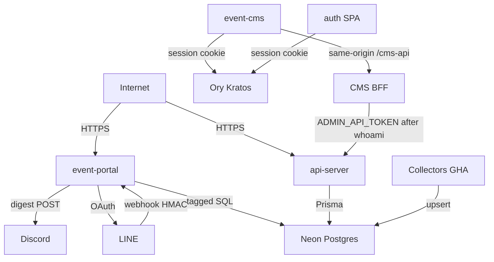

# Threat model — nx-playground event stack

## Executive summary

The internet-facing risk concentrates on **event-portal** (Vercel: LINE webhook, LINE Login token proxy, public exhibition search, weekly Discord digest) and **api-server** (Render: public catalog reads, shared-secret writes, organizer user/stats). Neon holds the published exhibition catalog, embeddings, and organizer `users` rows. LINE/Discord secrets and `DATABASE_URL` are the highest-value credentials. This pass closed two High gaps on Nest (unauthenticated `GET /users/:id`, public draft-event reads) and two further High organizer-auth gaps: production `X-Organizer-Email` is no longer an identity proof, and CMS no longer inlines `ADMIN_API_TOKEN` / organizer secrets into the Vite bundle. Residual High items in this model are closed; remaining open items are Medium/Low.

## Scope and assumptions

**In scope:** `apps/event-portal`, `apps/event-cms`, `apps/api-server`, `apps/auth`, `apps/api-mock`, `tools/collectors`, shared libs used by those apps, `render.yaml`, `vercel.json`, `.github/workflows/collect-*.yml`.

**Out of scope:** `apps/profile`, `apps/mobile-approvals`, `labs/`, Angular/Vue satellites, retired ticketing/ECPay (dropped in Prisma), and the Supabase `track-view` function (profile analytics, not event-stack).

**Assumptions** (inferred from repo + deployment files; they drive ranking):

- Production C-end is `nx-event-portal.vercel.app` with Neon `DATABASE_URL` on the Next.js server and LINE Messaging/Login configured.
- Nest is intended to be internet-reachable (`render.yaml` public web service) against the same Neon database.
- Organizers authenticate to **Ory Kratos**. Nest and the CMS Vite BFF call `sessions/whoami` before granting organizer/admin. Production does not honor `X-Organizer-Email` alone.
- Collectors run only as GitHub Actions / local CLI (no HTTP listener).
- `api-mock` on Vercel stays in-memory (`EVENT_STACK_STORE` not postgres).
- Catalog content is public once `status = 'published'`; drafts and `users` emails are not.

**Open questions that would change ranking:**

1. Is Nest on Render live today against production Neon, or still dark?
2. Is event-cms hosted (it must run the Vite `/cms-api` BFF; static-only hosting cannot write)?
3. Is a production Kratos public URL set as `KRATOS_PUBLIC_URL` on Render, or is organizer traffic bearer-only (`ADMIN_API_TOKEN`) until then?

## System model

### Primary components

| Component                | Runtime                   | Evidence                                                      |
| ------------------------ | ------------------------- | ------------------------------------------------------------- |
| event-portal             | Next.js on Vercel         | `vercel.json`, `apps/event-portal/src/app/api/**`             |
| api-server               | NestJS + Prisma on Render | `apps/api-server/src/main.ts`, `render.yaml`                  |
| event-cms                | Vite SPA                  | `apps/event-cms/vite.config.ts`                               |
| auth                     | Vite SPA → Kratos         | `apps/auth/src/route.tsx`                                     |
| api-mock                 | In-memory OpenAPI mock    | `apps/api-mock/src/handler.ts`                                |
| Collectors               | CLI / GitHub Actions      | `tools/collectors/**`, `.github/workflows/collect-taipei.yml` |
| Neon Postgres + pgvector | Shared catalog + users    | `apps/api-server/prisma/schema.prisma`                        |
| LINE / Discord           | External                  | webhook + OAuth routes; `DISCORD_WEBHOOK_URL`                 |

### Data flows and trust boundaries

- **Internet → event-portal (HTTPS).** Search query strings, LINE OAuth `code` + PKCE verifier, LINE webhook raw body. Controls: origin allowlist on token routes (`apps/event-portal/src/libs/line/request-origin.ts:12-25`), HMAC on webhook (`apps/event-portal/src/libs/line/bot/signature.ts:17-30`), per-isolate rate limits, `CRON_SECRET` on digest. Validation: query length cap 2048 (`search/route.ts:17-25`); webhook 256 KiB (`webhook/route.ts:16-44`).
- **LINE → event-portal webhook (HTTPS).** Messaging events. Control: `x-line-signature` HMAC-SHA256 over raw bytes; fail closed if `LINE_CHANNEL_SECRET` unset (`webhook/route.ts:36-48`). No replay/idempotency store.
- **event-portal → Neon (TLS, tagged SQL).** Keyword / region / date / optional embedding vector. Control: server-only `DATABASE_URL`; `status = 'published'` (`sql.ts:247`); bound parameters (`sql.ts:229-261`); ILIKE wildcards stripped (`sql.ts:99-104`).
- **event-portal → LINE token/profile APIs (HTTPS).** Authorization code + `LINE_CLIENT_SECRET`. Control: PKCE required; `redirect_uri` pinned server-side (`token/route.ts:97-110`). Returns access/id tokens to the browser (`token/route.ts:174-178`).
- **event-portal → Discord (HTTPS POST).** Digest text. Control: `CRON_SECRET` bearer (`digest/auth.ts:21-30`); webhook URL host/path allowlist (`publish.ts:10-38`); `allowed_mentions.parse = []` (`publish.ts:81-84`).
- **Internet → api-server (HTTPS `/api`).** Public event/catalog reads; Bearer `ADMIN_API_TOKEN` on event mutations; organizer users/stats require a verified Kratos session (allowlisted email) or `ADMIN_API_TOKEN`. Controls: CORS allowlist (`main.ts:29-38`); `ValidationPipe` whitelist (`main.ts:41-47`); `AdminBearerGuard` timing-safe fail-closed (`timing-safe-equal.ts:21-31`); `PermissionsGuard` fail-closed (`permissions.guard.ts:16-18`); production email-header deny (`organizer-identity.ts`).
- **event-cms browser → CMS BFF `/cms-api` → api-server.** Browser sends the Kratos cookie only. The Vite BFF verifies `sessions/whoami`, then attaches server-only `ADMIN_API_TOKEN` (`apps/event-cms/server/cms-bff.ts`). No organizer/admin secret is in the client bundle (`event-cms/vite.config.ts` `define`).
- **event-cms / auth → Kratos.** Browser cookie `sessions/whoami`. Control lives in Kratos, not this repo.
- **GitHub Actions collectors → Neon.** Full `DATABASE_URL` upsert (`collect-taipei.yml:47-56`). Outbound fetch: HTTPS allowlist + `redirect: 'error'` (`tools/collectors/shared/ssrf.ts:60-100`).
- **Internet → api-mock.** Unauthenticated event writes if that process is reachable (`handler.ts` POST/PUT/DELETE). Assumed not production.

#### Diagram

## Assets and security objectives

| Asset                                         | Why it matters                                        | Security objective (C/I/A) |
| --------------------------------------------- | ----------------------------------------------------- | -------------------------- |
| Neon `events` + embeddings                    | Public catalog integrity; drafts are unpublished work | I, A (C for drafts)        |
| Neon `users` (email, role, status)            | Organizer PII and privilege state                     | C, I                       |
| Neon `sessions.token`                         | Session material if ever exposed via includes         | C                          |
| `DATABASE_URL`                                | Full catalog/user read-write                          | C, I                       |
| `LINE_CHANNEL_SECRET` / access token          | Forge webhooks; reply as the OA                       | C, I                       |
| `LINE_CLIENT_SECRET`                          | Token-proxy abuse                                     | C                          |
| LINE user access/id tokens                    | Impersonate the attendee on LINE APIs                 | C                          |
| `ADMIN_API_TOKEN` (server-only)               | Mutate catalog; admin on users/stats                  | C, I                       |
| `CRON_SECRET` / `DISCORD_WEBHOOK_URL`         | Spam or hijack the digest channel                     | I, A                       |
| `EMBEDDING_API_KEY`                           | Paid outbound inference                               | C, A                       |
| Published search availability                 | LINE bot + portal discovery                           | A                          |

## Attacker model

### Capabilities

- Unauthenticated HTTPS to portal and Nest from the internet.
- Ability to POST LINE-shaped JSON (without a valid HMAC unless the channel secret leaks).
- Ability to set arbitrary HTTP headers (`X-Organizer-Email`, `Authorization`, `Origin`).
- XSS in the portal origin would read `localStorage` (LINE tokens, PKCE verifier).
- Read public CMS JavaScript if event-cms is hosted.
- Trigger or observe GitHub Actions if they have a compromised `repo`/`workflow` token (separate from app attackers).

### Non-capabilities

- No assumed access to Vercel/Render/Neon dashboards or GitHub `secrets.DATABASE_URL`.
- Cannot rewrite collector allowlists without a code change in CI.
- Cannot force portal search to return `draft` rows (SQL `status = 'published'`).
- Discord is outbound-only; there is no inbound Discord slash-command surface.
- Collectors are not HTTP servers.

## Entry points and attack surfaces

| Surface                                  | How reached          | Trust boundary                   | Notes                                 | Evidence                                           |
| ---------------------------------------- | -------------------- | -------------------------------- | ------------------------------------- | -------------------------------------------------- |
| `GET /api/exhibitions/search`            | Public               | Internet → portal → Neon         | Rate limited; published only          | `search/route.ts:19-64`                            |
| `POST /api/line/webhook`                 | LINE / anyone        | Internet → portal                | HMAC + 256 KiB cap; no replay store   | `webhook/route.ts:28-57`                           |
| `POST /api/line/auth/token`              | Browser / script     | Internet → portal → LINE         | PKCE; missing Origin allowed          | `token/route.ts:49-110`, `request-origin.ts:12-14` |
| `POST /api/line/auth/id-token`           | Browser / script     | Internet → portal → LINE         | Origin + LINE verify                  | `id-token/route.ts`                                |
| `GET\|POST /api/cron/weekly-digest`      | Vercel cron / anyone | Internet → portal → Discord/Neon | Fail-closed bearer                    | `digest/auth.ts:21-30`                             |
| `GET /api/events`, `GET /api/events/:id` | Public               | Internet → Nest → Neon           | Published-only unless admin bearer    | `events.controller.ts:52-86`                       |
| `POST\|PUT\|DELETE /api/events`          | Bearer               | Internet → Nest                  | `ADMIN_API_TOKEN`                     | `events.controller.ts:89-118`                      |
| `GET\|POST\|PUT\|DELETE /api/users`      | Organizer middleware | Internet → Nest                  | Permissions required on every handler | `users.controller.ts:28-52`                        |
| `GET /api/stats`                         | Organizer middleware | Internet → Nest                  | `users:read`                          | `stats.controller.ts:9-20`                         |
| `POST /api/catalog/items`                | Public               | Internet → Nest memory           | In-process demo catalog, not Neon     | `catalog.controller.ts:42-46`                      |
| `/api/docs`, `/api-json`                 | Public               | Internet → Nest                  | OpenAPI disclosure                    | `main.ts:49-68`                                    |
| Labelled-demo `/api/[...path]`           | Public               | Internet → portal memory         | GET events only                       | `labelled-demo-bff.ts:25-37`                       |
| Collectors                               | GHA / CLI            | CI → Neon / source hosts         | SSRF allowlist                        | `ssrf.ts:60-100`                                   |

## Top abuse paths

1. **Spoof organizer admin (fixed).** `X-Organizer-Email` is ignored in production. Nest requires a verified Kratos session on `ALLOWED_ORGANIZER_EMAILS` or `ADMIN_API_TOKEN`.
2. **Extract CMS bearer from static JS (fixed).** The Vite bundle no longer defines organizer/admin tokens. CMS writes go through `/cms-api`, which attaches `ADMIN_API_TOKEN` only after whoami.
3. **Read unpublished catalog (fixed).** `GET /api/events?status=draft` or `GET /api/events/<draftId>` used to return drafts; portal search did not. Now anonymous callers are forced to `published`.
4. **Enumerate users (fixed).** `GET /api/users/:id` had `PermissionsGuard` but no `@RequirePermissions`, and the guard allowed empty metadata. Now denied.
5. **Steal LINE tokens via XSS.** Inject script on the portal origin → read `nx-playground_liff_user_info` / login state → call LINE APIs as the user. Open (needs XSS).
6. **Replay a captured LINE webhook.** Valid HMAC body replayed → duplicate replies / search load. Open (Medium).
7. **Saturate search/LINE isolates.** Burst `/api/exhibitions/search` or webhook across many Vercel isolates → Neon/embedding cost and LINE 429s. Open.
8. **Poison the catalog via collector credentials.** Compromised `secrets.DATABASE_URL` or a malicious allowlisted source → upsert published events that the portal and LINE bot serve. Open (needs CI or source compromise).
9. **Mis-deploy api-mock with Postgres.** Unauthenticated POST/PUT/DELETE persist to Neon. Conditional on ops mistake.

## Threat model table

| Threat ID | Threat source                         | Prerequisites                                        | Threat action                                         | Impact                                                            | Impacted assets               | Existing controls (evidence)                                                                                                                                                    | Gaps                                                                                         | Recommended mitigations                                                            | Detection ideas                                              | Likelihood      | Impact severity | Priority          |
| --------- | ------------------------------------- | ---------------------------------------------------- | ----------------------------------------------------- | ----------------------------------------------------------------- | ----------------------------- | ------------------------------------------------------------------------------------------------------------------------------------------------------------------------------- | -------------------------------------------------------------------------------------------- | ---------------------------------------------------------------------------------- | ------------------------------------------------------------ | --------------- | --------------- | ----------------- |
| TM-001    | Remote unauthenticated                | Nest reachable; user id guessable/leaked             | `GET /api/users/:id` without credentials              | Organizer email/role disclosure                                   | Neon `users`                  | **Fixed:** `@RequirePermissions('users:read')` (`users.controller.ts:51-52`); guard fail-closed (`permissions.guard.ts:16-18`); stale `orders` include removed                  | Class-level guard still depends on decorators; no Nest-wide default deny                     | Keep fail-closed; add e2e that unauthenticated `:id` is 403                        | 403/401 spike on `/api/users`                                | Low (after fix) | High            | **high (fixed)**  |
| TM-002    | Remote unauthenticated                | Nest reachable; event id known                       | Read or filter `draft` events on public GET           | Unpublished catalog leak                                          | Neon `events` drafts          | **Fixed:** anonymous list forced to `published`; unpublished detail → 404 (`public-event-read.ts`, `events.controller.ts:65-85`). Portal search already filtered (`sql.ts:247`) | CMS draft list now requires `ADMIN_API_TOKEN`                                                | Same bearer for CMS list as for writes; do not add a second public status filter   | Queries with `status=draft` from non-admin IPs               | Low (after fix) | High            | **high (fixed)**  |
| TM-003    | Remote with guessed email             | Production Nest; email in `ALLOWED_ORGANIZER_EMAILS` | Send `X-Organizer-Email` only                         | Full admin on users/stats (`*:*`)                                 | Users, stats                  | **Fixed:** production ignores email headers and `EVENT_STACK_CMS_DEV_AUTH`; Kratos `sessions/whoami` + allowlist or `ADMIN_API_TOKEN` (`organizer-identity.ts`)                  | Dev-only email path remains when `EVENT_STACK_CMS_DEV_AUTH=true` and `NODE_ENV!==production` | Keep production fail-closed; do not re-enable header-only auth                     | Auth successes with no session/bearer                        | Low (after fix) | High            | **high (fixed)**  |
| TM-004    | Anyone who can fetch CMS JS           | Hosted CMS static bundle                             | Extract token from bundle; replay to Nest             | Admin users/stats; catalog mutation                               | Tokens, events, users         | **Fixed:** no `VITE_*` admin/organizer token in `define`; `/cms-api` BFF attaches `ADMIN_API_TOKEN` after whoami (`event-cms/server/cms-bff.ts`)                                 | Hosted CMS must run the BFF (static-only cannot write)                                       | Keep `ADMIN_API_TOKEN` server-only; never add `VITE_CMS_*` tokens                   | Token use from non-CMS origins                               | Low (after fix) | High            | **high (fixed)**  |
| TM-005    | XSS on portal origin                  | XSS gadget in portal                                 | Read `localStorage` LINE tokens                       | Attendee LINE session theft                                       | LINE access/id tokens         | Refresh token no longer returned; PKCE on code exchange                                                                                                                         | Tokens still JSON’d to the client (`token/route.ts:174-178`) and stored (`storage.ts:36-48`) | httpOnly server session; never persist access tokens in JS                         | CSP violation reports; token-endpoint anomalies              | Medium          | Medium          | **medium (open)** |
| TM-006    | Unauthenticated flood                 | Portal URL known                                     | Burst search / webhook / token routes across isolates | Neon/embed cost; LINE bot unavailable                             | Search, LINE, compute         | Per-isolate limits (`exhibition-search/rate-limit.ts`, LINE rate-limit); query cap 2048                                                                                         | Maps are not shared across Vercel isolates                                                   | Vercel WAF / Redis limiter                                                         | 429 ratio; Neon CU spikes                                    | Medium          | Medium          | **medium (open)** |
| TM-007    | Network observer / retry              | Captured valid LINE POST                             | Replay signed webhook                                 | Duplicate replies; search amplification                           | LINE channel, Neon read       | HMAC + body cap (`webhook/route.ts:41-48`)                                                                                                                                      | No event-id dedup                                                                            | Persist LINE `event.webhookEventId` with TTL                                       | Repeat `webhookEventId`                                      | Medium          | Low             | **medium (open)** |
| TM-008    | Compromised GHA secret or source host | `DATABASE_URL` in Actions or allowlisted origin      | Upsert attacker-controlled published events           | Visitors/LINE see poisoned catalog                                | Events integrity              | SSRF allowlist + no redirects (`ssrf.ts:83-100`); unique `(source, externalId)`                                                                                                 | Actions has full DB write; sources are trusted                                               | Least-privilege DB role; signed source artifacts; review upsert diffs              | Unusual upsert volume/source                                 | Low             | High            | **medium (open)** |
| TM-009    | Remote unauthenticated                | api-mock or catalog demo exposed                     | Unauthenticated writes                                | Mock/demo integrity; Neon if mock mis-wired                       | api-mock store; possibly Neon | Portal labelled-demo is GET-only; mock defaults to memory on Vercel                                                                                                             | `POST /catalog/items` has no guard; mock handler writes are open                             | Gate mock writes; add bearer on catalog POST or disable in prod                    | Write verbs on mock/catalog hosts                            | Low             | Medium          | **low (open)**    |
| TM-010    | Internet scanner                      | Nest `/api/docs` public                              | Map mutating routes and auth scheme                   | Faster follow-on attacks                                          | API surface                   | Intended demo Swagger (`main.ts:49-68`)                                                                                                                                         | No auth on OpenAPI JSON                                                                      | Disable Swagger in production or gate it                                           | Unusual `/api-json` traffic                                  | High            | Low             | **low (open)**    |

## Criticality calibration

For this repo (public exhibition catalog + organizer emails + LINE bot):

- **Critical:** Pre-auth RCE; theft of `DATABASE_URL` / LINE channel secret; unauthenticated Neon catalog wipe or user-table rewrite.
- **High:** Auth bypass to users/stats or event mutations; unpublished catalog disclosure; client-bundled mutating token (now mitigated); cross-tenant data (N/A today — single tenant).
- **Medium:** Targeted DoS of search/LINE; XSS-driven LINE token theft; webhook replay; collector integrity without secret theft.
- **Low:** OpenAPI disclosure; in-memory catalog POST; ILIKE wildcard noise; unused JsonLd `</script>` footgun (`JsonLd.tsx:19`).

## Focus paths for security review

| Path                                                          | Why it matters                             | Related Threat IDs     |
| ------------------------------------------------------------- | ------------------------------------------ | ---------------------- |
| `apps/api-server/src/common/auth/organizer-identity.ts`       | Session + allowlist; production email deny | TM-003                 |
| `apps/api-server/src/middleware/organizer-auth.middleware.ts` | Applies identity to users/stats            | TM-003                 |
| `apps/api-server/src/guards/permissions.guard.ts`             | AuthZ choke point for users/stats          | TM-001                 |
| `apps/api-server/src/modules/users/users.controller.ts`       | User PII API                               | TM-001, TM-003         |
| `apps/api-server/src/modules/events/events.controller.ts`     | Public vs admin event reads/writes         | TM-002                 |
| `apps/api-server/src/modules/events/public-event-read.ts`     | Published-only rule                        | TM-002                 |
| `apps/event-cms/vite.config.ts`                               | Client define has no secrets               | TM-004                 |
| `apps/event-cms/server/cms-bff.ts`                            | Same-origin write proxy                    | TM-003, TM-004         |
| `apps/event-portal/src/app/api/line/webhook/route.ts`         | Inbound LINE                               | TM-006, TM-007         |
| `apps/event-portal/src/app/api/line/auth/token/route.ts`      | Client-secret proxy                        | TM-005                 |
| `apps/event-portal/src/libs/exhibition-search/sql.ts`         | Hybrid FTS + pgvector                      | TM-006                 |
| `tools/collectors/shared/ssrf.ts`                             | Outbound fetch policy                      | TM-008                 |
| `.github/workflows/collect-taipei.yml`                        | Privileged DB writes from CI               | TM-008                 |
| `apps/api-mock/src/handler.ts`                                | Unauthenticated mock writes                | TM-009                 |
| `apps/event-portal/src/libs/digest/publish.ts`                | Discord outbound                           | TM-006                 |
| `apps/api-server/prisma/schema.prisma`                        | Data classes; no RLS                       | TM-001, TM-002, TM-008 |

## Notes on residual controls

Portal search, LINE webhook HMAC, collector SSRF, Discord URL allowlist, cron bearer, and Nest event-mutation bearer were already in good shape (see `docs/security/audit-2026-10.md`). Nest **read** hardening (users + drafts) landed in #55. Organizer identity now requires a Kratos session or `ADMIN_API_TOKEN`; CMS writes go through a server-side BFF so no admin/organizer secret reaches the browser.

## Quality check

- Entry points in the table are covered by at least one threat or an explicit “intentionally public / published-only” note.
- Each trust boundary appears in at least one abuse path (portal, Nest, CMS→Nest, collectors→Neon, LINE, Discord, CI).
- Runtime vs CI: collectors/Actions called out separately (TM-008); tests/examples not treated as production.
- User context: scope taken from the request (portal, Nest, collectors, LINE/Discord, Neon, Vercel). Nest-on-Render liveness and hosted CMS remain open questions above.
- Assumptions and open questions are listed in **Scope and assumptions**.
